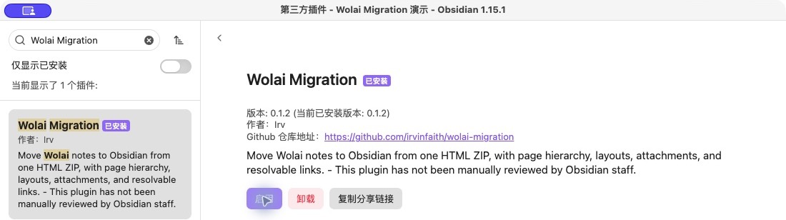
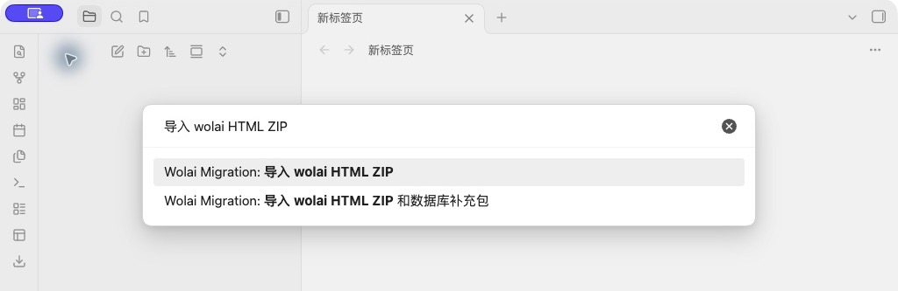
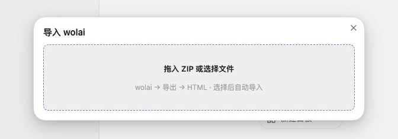
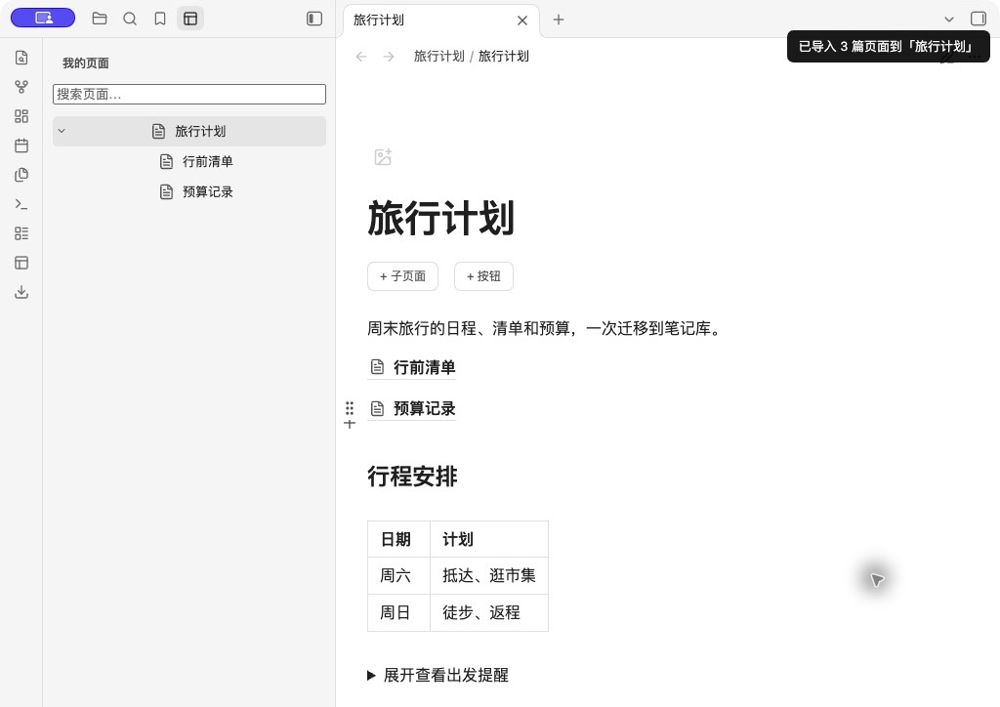

# Wolai Migration

**从 wolai 无痛迁移到 Obsidian。拖入从 wolai 导出的 ZIP 包，笔记就能接着用。**

wolai 和 Obsidian 的页面组织方式不同，搬家时最费工的是重搭页面树、重新排版、找回图片和接好链接。Wolai Migration 会把原来的子页面层级、分栏、折叠和表格转换成适合 Obsidian 阅读的结构，让图片、附件和可解析的内链一起迁过去。

[从这里打开导入窗口](#1-打开导入窗口) · [Obsidian 社区插件页](https://community.obsidian.md/plugins/wolai-migration) · [查看迁移范围](#会迁移什么) · [English summary](#english-summary)

## 安装

当前版本支持 **Obsidian 桌面版 1.15.1 或更高**。先打开你要导入到的笔记库。

1. 打开「设置 → 第三方插件 → 浏览」。如果看到「退出受限模式」，先点击它，再进入「浏览」。
2. 搜索 **Wolai Migration**，打开详情，依次点击 **「安装」** 和 **「启用」**。按钮变成「禁用」即表示插件已启用。

从 GitHub 手动安装

1. 在 [GitHub Releases](../../releases/latest) 下载 `wolai-migration-版本号.zip`。
2. 把解压出来的 `wolai-migration` 文件夹放到笔记库的 `.obsidian/plugins/` 目录。
3. 重新打开 Obsidian，在「设置 → 第三方插件」的已安装列表中启用 **Wolai Migration**。

也可以下载单独的 `main.js`、`manifest.json` 和 `styles.css`，放入 `.obsidian/plugins/wolai-migration/`。

## 三步迁移

### 1. 打开导入窗口

**关闭插件市场和设置窗口，回到笔记库主界面。** 按 **`⌘P`**（macOS）或 **`Ctrl+P`**（Windows、Linux）打开命令面板，搜索 **「导入 wolai HTML ZIP」**，选中下图第一项 **「Wolai Migration: 导入 wolai HTML ZIP」**，按回车。

也可以点图中最左侧竖栏的 **下载图标**，悬停时会显示「导入 wolai ZIP」。左侧功能区隐藏时，用命令面板就能打开。

### 2. 拖入从 wolai 导出的 ZIP 包

在 wolai 里选「导出 → HTML」，把下载的 ZIP 原样拖到「导入 wolai」窗口的虚线框内。也可以点击虚线框选择文件。选中后会自动开始导入。

### 3. 查看导入结果

看到「已导入 … 篇页面」后，Obsidian 会自动打开迁移后的根页面。左侧 **「我的页面」** 可以展开目录并打开子页面。

每次迁移都会在当前笔记库下按根页面名称新建目录，遇到同名会自动编号。可以在阅读视图查看迁移后的布局，并在该目录的 `_wolai/迁移报告.md` 查看导入数量和无法转换的引用。

## 会迁移什么

| 内容 | 导入结果 |
| --- | --- |
| 页面、标题、列表、待办、引用 | Markdown 笔记，保留可识别的顺序和层级 |
| 页面卡片、分栏、折叠、普通表格 | 在阅读视图中呈现，包括表格合并单元格和图片位置 |
| 图片、视频、文档和 Excel | 保存 ZIP 中提供的附件，Excel 可在阅读视图预览 |
| 页面和块引用 | 导出包里有目标时生成 Obsidian 内链。目标缺失时保留 wolai 原地址，并列在迁移报告里 |
| 多维表格 | HTML 只包含原表链接时保留入口。有对应的 CSV、Excel 或数据库补充包时，可生成原生 Bases |

如何导入多维表格到原生 Bases？

如果你手上有原表的数据文件，可把它和从 wolai 导出的 HTML ZIP 一起迁移。请在 Obsidian 启用 **Bases** 核心插件，以查看原生 `.base` 表格。

1. 用 `⌘P` 或 `Ctrl+P` 打开命令面板，执行 **「导入 wolai HTML ZIP 和 CSV / Excel 表格」**，选择原始 HTML ZIP。
2. 从识别出的多维表格入口中选择一项。窗口会显示入口所在页面和 wolai 原链接，便于确认是哪张表。选择对应的 `.csv` 或 `.xlsx`，Excel 可选择工作表。确认表名后点击 **「添加表格」**。
3. 有其他表格时可重复第 2 步。点 **「开始导入」** 后，对应入口会显示为原生 Base，每条记录保存成一篇笔记。没有表格数据时点 **「只导入页面」**，原表链接保留。迁移报告会列出实际使用的表格文件。

文件以首个非空行为表头，首列用于给记录笔记命名，单元格按文本导入。Excel 公式使用文件中保存的结果，日期可能显示为 Excel 序号。每个文件最大 16 MiB、256 列，每批最多 10,000 条记录、500,000 个单元格。

需要迁移正文中的行引用时，在表格里加一列 **`Wolai 原记录链接`**，把每条记录的原链接作为单元格内容。插件只按唯一且可匹配的原始 ID 生成内链，目标缺失或有歧义时保留原地址。表格文件只提供字段值，原记录正文、附件及原有视图需要另外提供。

**已有完整数据库补充包？** 在命令面板执行「导入 wolai HTML ZIP 和数据库补充包」，依次选择原始 HTML ZIP 和补充包。

如果你以前用 wolai-local 保存过数据库，可以按 [贡献指南](CONTRIBUTING.md#制作可选的-bases-补充包) 生成本地补充包。它只提供匹配的数据库、记录、记录附件和封面。补充包可能包含私人笔记，请保存在本机。

导入大文件、取消与重试

ZIP 上限为 768 MiB，解压总量上限为 1 GiB，单个条目上限为 256 MiB，最多 20,000 个条目。遇到超限可在 wolai 里按子页面分批导出。

取消或写入失败时，插件会尝试清理本次创建的文件，并提示仍需检查的项目。重新选择 ZIP 即可重试。

## 隐私与反馈

插件在本机处理选中的 ZIP 和表格文件，结果写入当前笔记库。页面导航和 Wolai 阅读样式只应用于插件管理的导入批次。外链图片与封面可以向导出文件记载的地址发起请求，点击保留的网页链接也会打开对应站点。

遇到问题可提交 [Issue](../../issues/new/choose)。请附插件版本、Obsidian 版本、操作步骤和已脱敏的最小样例。安全问题使用[私密报告渠道](SECURITY.md)。

欢迎查看 [贡献指南](CONTRIBUTING.md) 和 [更新日志](CHANGELOG.md)。

## English summary

Move your Wolai notes to Obsidian in one step after export. The importer preserves local pages, attachments, and resolvable links.

### Installation

On Obsidian Desktop 1.15.1 or later, open **Settings → Community plugins → Browse**. Search for **Wolai Migration**, then select **Install** and **Enable**. The [installation screenshot](#安装) also shows where to find the Enable button.

### Usage

Export your notes from Wolai as HTML and keep the ZIP. Close the plugin browser and Settings to return to your vault. Press **Cmd+P** on macOS or **Ctrl+P** on Windows and Linux, then run **Wolai Migration: 导入 wolai HTML ZIP**. The download icon on the left ribbon opens the same dialog. Drop or select the export ZIP to start importing. Obsidian opens the migrated root note and shows its child pages on the left. See the [illustrated walkthrough](#三步迁移) for the screens and `_wolai/迁移报告.md` in the new folder for the migration report.

A Wolai link keeps its original address when there is no verified local target. If the HTML ZIP only includes a database link, run **导入 wolai HTML ZIP 和 CSV / Excel 表格** to match a CSV or Excel worksheet to the database and import its records into a native Base. An optional `Wolai 原记录链接` column links imported records by their original IDs.

Build and test locally with `npm ci`, `npm test`, and `npm run build`. See [Contributing](CONTRIBUTING.md) for fixtures and releases.

## 许可证

[MIT](LICENSE)。第三方组件归属见 [THIRD_PARTY_NOTICES.md](THIRD_PARTY_NOTICES.md)。
